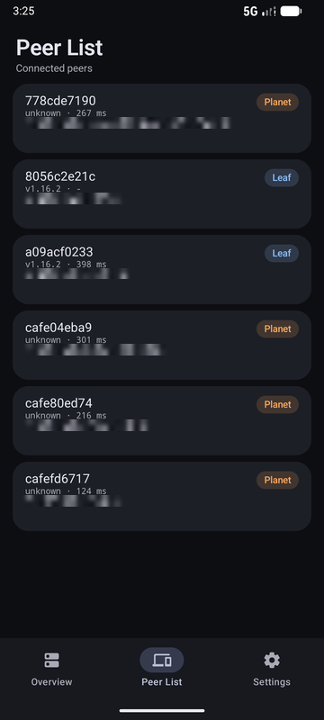

# Zotiera


中文 | [English](docs/en/README.md)

非官方 [ZeroTier](https://www.zerotier.com/) Android 客户端，具有最新的 Material/Miuix 外观和多网络同时在线功能。

## 功能

- 同时加入并连接多个 ZeroTier 网络：网络行的开关表示加入 / 离开，设备卡上的总开关只管隧道
- 快捷设置磁贴直接开关隧道，连接期间通知常驻
- 两套界面风格（Miuix / Material 3），深浅色与纯黑背景
- 自定义 planet（文件或 HTTPS URL）、moon 轨道管理与 `.moon` 导出
- 网络详情（状态、MAC、MTU、DNS、分配地址）与对等节点列表（角色、版本、延迟、首选路径）
- DNS 三种模式：不使用 / 网络下发 / 自定义
- 中英文界面，API 33+ 可在系统设置里单独设置本应用语言

## 截图



Material 深色风格。模拟器渲染不出 Miuix 风格的字体与控件观感，Miuix 在实机上才是设计的样子。
其余截图见 [`assets/images/screenshots/`](assets/images/screenshots/readme.md)。

## 要求

- Android 11（API 30）及以上
- 仅 64 位：`arm64-v8a`、`x86_64`

## 构建

```sh
git submodule update --init --recursive
./gradlew :app:assembleDebug        # 本地调试
./gradlew :app:assemblePr           # 测试通道，包名 net.sumitm.zotiera.pr
./gradlew :app:assembleRelease      # 正式包，需要 4 个 ANDROID_* 环境变量
```

正式签名读取 `ANDROID_KEYSTORE_BASE64`、`ANDROID_KEYSTORE_PASSWORD`、
`ANDROID_KEY_ALIAS`、`ANDROID_KEY_PASSWORD`；缺任何一个都不会产出签名包。
`.pr` 通道使用 `assets/ci/signing/pr.keystore` 里的公开测试密钥，只用于自测，不可分发。

## 版本号

以 ZeroTier 引擎版本为基准：`versionName = <engine>-<revision>`（如 `1.16.2-1`），
`versionCode = major*1e6 + minor*1e4 + patch*100 + revision`。引擎版本号唯一来源是
`externals/core/version.h`，修订号在 `version.txt`。

## 文档

- [现状与架构](docs/agent/architecture.md)
- [未完成计划](docs/agent/plan/)
- [界面截图](assets/images/screenshots/readme.md)

## 鸣谢

界面布局参考 [KernelSU](https://github.com/tiann/KernelSU)。

## 许可与来源

本项目按 **AGPL-3.0-or-later** 授权，见 [LICENSE](LICENSE)。

ZeroTier 核心 `externals/core`（1.16.2 起）为 **MPL-2.0**，来自
[zerotier/ZeroTierOne](https://github.com/zerotier/ZeroTierOne)。

ZeroTier 是 ZeroTier, Inc. 的商标。本项目与 ZeroTier, Inc. 无隶属或背书关系。
