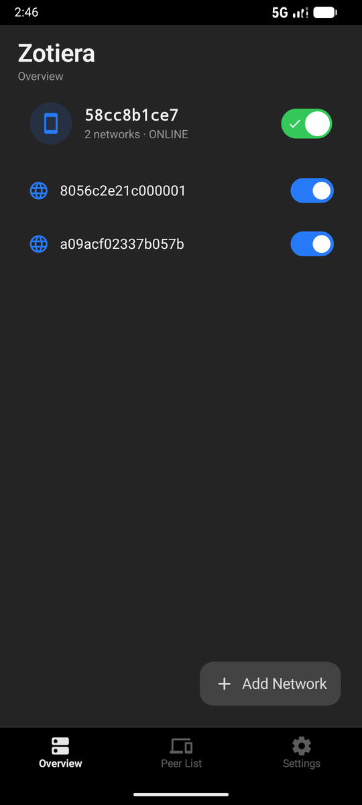
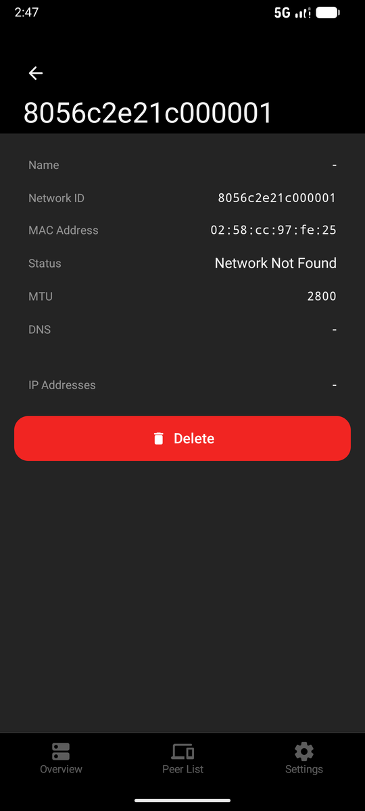
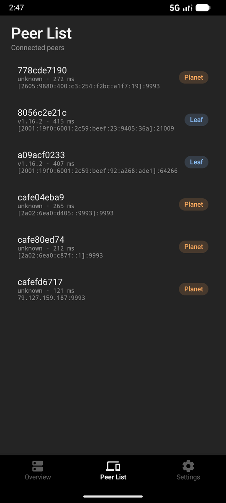
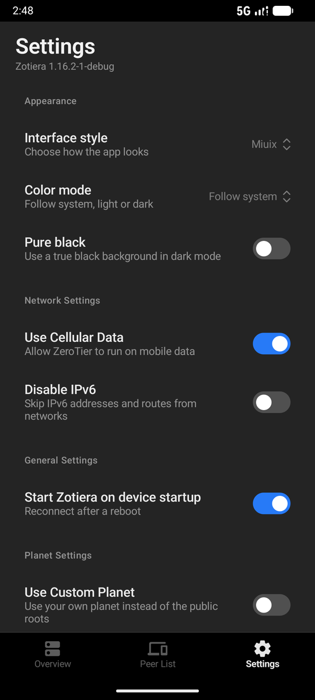
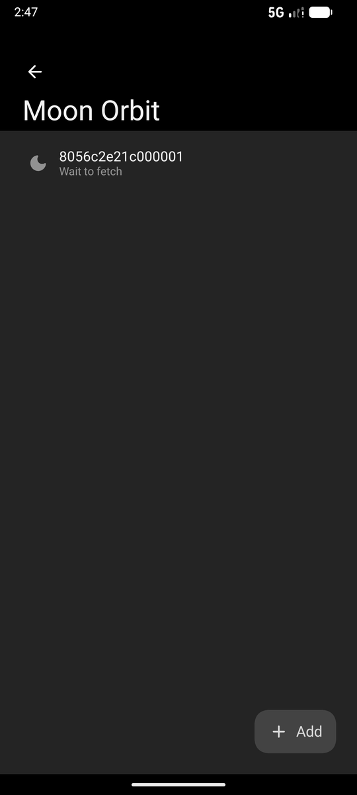
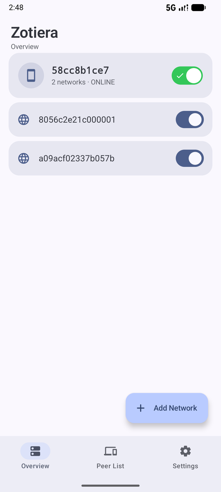

# 界面截图

构建 `1.16.2-1-debug` · Android 模拟器 x86_64 · 1080×2400 / 420dpi · 系统深色

前五张是默认风格（Miuix + 颜色模式跟随系统），后两张是 Material 风格。

> 测试用的两个网络 ID 在控制端不存在，所以状态显示 `Network Not Found`、也没有分配地址；
> 这只是测试数据的问题，界面本身不受影响。
>
> 模拟器渲染不出 Miuix 风格的字体与控件观感，这一套图里 Miuix 的观感与实机有差异，实机为准。

## 概览

设备卡：节点 ID、`N 个网络 · 在线`、隧道总开关（连上时整条变绿并出现对勾）；
下面每行一个网络，开关是加入/离开，点行进入详情。

## 网络详情

名称 / 网络 ID / MAC / 状态 / MTU / DNS 一张卡，分配地址单独一张卡，最下面是整块红色的删除。

## 对等节点

`节点 ID` + `版本 · 延迟` + 首选路径；角色用行尾胶囊区分（根服务器橙、Moon 紫、叶结点蓝）。

## 设置

外观（界面风格、颜色模式、纯黑）、网络、通用、planet，以及 moon 入口。

## 月亮

已入轨的 moon 列表，长按某一行可以导出 `.moon`。

## Material · 浅色

同一页换成 Material 3 + 浅色的样子。

## Material · 深色（对等节点）

根 README 用的就是这张：Material 3 深色下的对等节点，角色胶囊在右侧（IP 已打码）。

