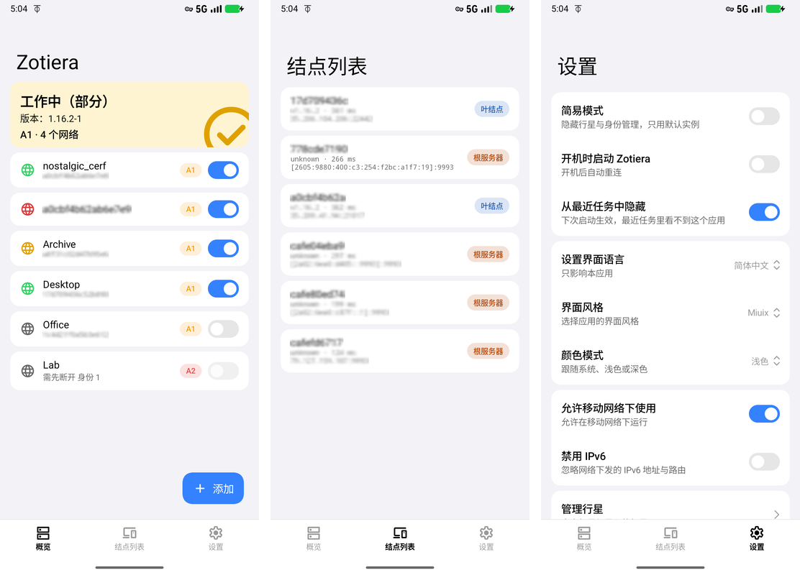
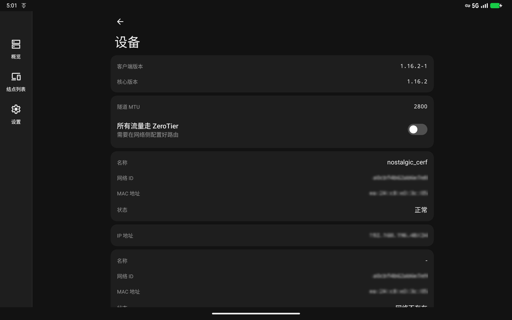

# Zotiera


[中文](../../README.md) | English

An unofficial [ZeroTier](https://www.zerotier.com/) client for Android, with a current
Material / Miuix look and several networks online at the same time.

## Features

- Join and connect several ZeroTier networks at once: the switch on a network row means join / leave,
  the master switch on the device card only controls the tunnel
- A quick settings tile toggles the tunnel; a notification stays while connected
- Two UI styles (Miuix / Material 3), light, dark and pure black
- Custom planet (file or HTTPS URL), moon orbit management and `.moon` export
- Network details (status, MAC, MTU, DNS, assigned addresses) and a peer list (role, version,
  latency, preferred path)
- Three DNS modes: none / network DNS / custom
- Identity import / export (zip with both key files)
- Seven UI languages (English, Chinese, French, Russian, Spanish, Japanese, or follow system);
  on Android 13+ the app language can also be set in system settings

## Screenshots



Left: overview · middle: peer list · right: settings



Tablet ratio (16:10) in dark Material style: the bottom tabs become a navigation rail; the overview
stays in the left column and the device page (long-press the status card) opens in the right pane.

## Requirements

- Android 11 (API 30) or newer
- 64-bit only: `arm64-v8a`, `x86_64`

## Building

```sh
git submodule update --init --recursive
./gradlew :app:assembleDebug        # local debug build
./gradlew :app:assemblePr           # test channel, package name net.sumitm.zotiera.pr
./gradlew :app:assembleRelease      # release build, needs the 4 ANDROID_* variables
```

The release build reads `ANDROID_KEYSTORE_BASE64`, `ANDROID_KEYSTORE_PASSWORD`,
`ANDROID_KEY_ALIAS` and `ANDROID_KEY_PASSWORD`; if any of them is missing the build fails
instead of producing an unsigned package. The `.pr` channel uses the public test key in
`assets/ci/signing/pr.keystore` and must not be distributed.

## Versioning

Versions follow the ZeroTier engine: `versionName = <engine>-<revision>` (e.g. `1.16.2-1`),
`versionCode = major*1e6 + minor*1e4 + patch*100 + revision`. The engine version comes from
`externals/core/version.h`, the revision from `version.txt`.

## Docs

- [User guide](../user-guide.md) (Chinese)
- [Migrating an identity from ZerotierFix](../migrate-from-zerotierfix.md) (Chinese)
- [Contributing translations](../i18n-contributing.md) (Chinese and English)
- [Differences from upstream ZerotierFix](../fork-comparison.md) (Chinese)
- [Architecture and current state](../agent/architecture.md) (Chinese)
- [Open plans](../agent/plan/) (Chinese)

## License and credits

UI layout follows [KernelSU](https://github.com/tiann/KernelSU).

This project is licensed under **AGPL-3.0-or-later**, see [LICENSE](../../LICENSE).

The ZeroTier core in `externals/core` (since 1.16.2) is **MPL-2.0**, taken from
[zerotier/ZeroTierOne](https://github.com/zerotier/ZeroTierOne).

ZeroTier is a trademark of ZeroTier, Inc. This project is not affiliated with or endorsed by
ZeroTier, Inc.
