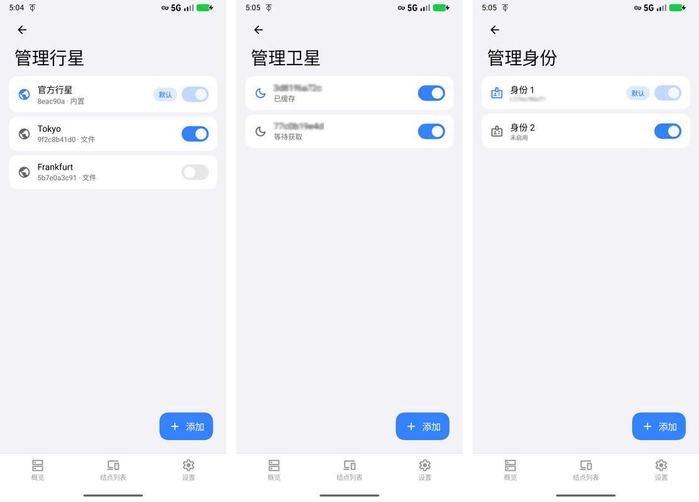

# 使用指南

Zotiera 把 ZeroTier 网络接到手机上：加入网络、开关隧道、看对端和分配到的地址。下面按三个入口走一遍。
截图取自默认的 Miuix 风格与浅色模式。

## 主页

概览页最上面那张卡是总开关，单击开关隧道、长按进设备页。卡片上依次是状态、版本号和「实例 · 已加入的网络数」。
状态靠底色区分：绿底表示已加入的网络全部连上；黄底的「工作中（部分）」表示还有网络在连；隧道刚启动、
节点还没上线时也是黄底「连接中」；隧道关着是黄底停止图标；一个网络都没有、或者加入的全被控制器拒绝时是红底大叉。

下面一行一个网络，行尾开关只管这一条是否加入，和上面的总开关是两件事。行首的地球图标是这条网络自己的状态——
绿色已连上、黄色还在等控制器回话、红色被拒绝、灰着就是没加入；行中间的 `A1` 标的是这条网络用哪个实例，
含义见最后一节。

添加网络点右下角「添加」，填 16 位网络 ID（控制器网络页可以直接复制）。私有网络还要在控制器里批准这个节点，
否则会一直停在等待或者直接被拒。第一次使用时系统会先要一次授权，允许本应用建立系统级的网络连接；
不授权隧道建不起来，卡片会一直显示未连接。

**结点列表**一页是对端：中间是版本和延迟，右侧胶囊标角色（根结点、叶结点、月结点）。
**设置**一页分通用、外观、网络、管理四组，日常会动的主要是外观里的界面语言、界面风格、颜色模式，
以及网络里的「允许移动网络下使用」和「禁用 IPv6」。

## 平板

屏幕够宽时（平板、折叠屏展开）底部标签会变成左侧的导航栏，页面也分成两栏：左栏是你当前所在的页面，
右栏是点进去的下一层。上图是深色模式下长按设备卡的样子——概览还留在左边，设备页占右边，
里面是客户端与核心版本、隧道 MTU、是否全局代理，以及每个网络的详情。按返回键收起右栏，左栏不动。

## 行星 / 卫星 / 身份

ZeroTier 里「行星」决定连到哪个根服务器，「身份」决定这台设备是哪个节点，两者组合起来就是网络行上那个胶囊。
默认只有官方行星和一个默认身份，所以设置里默认打开「简易模式」把这些入口藏起来；要自建根服务器、
或者在同一个应用里跑多个节点身份，先关掉简易模式，设置页底部就会出现上面这三个入口。

行星页管自建 planet，可以从文件导入或填 HTTPS 地址，停用的行星留着但不会参与连接；卫星页接入 moon 加速首次回连，
没接入时是空列表；身份页管节点 ID 与密钥，换身份等于换节点，控制器那边要重新批准，所以换之前会先确认。
导出身份、跨设备搬移的做法见 [从 ZerotierFix 迁移身份](migrate-from-zerotierfix.md)。
